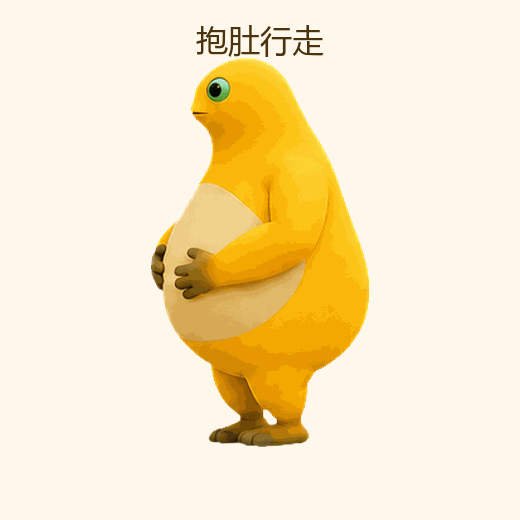
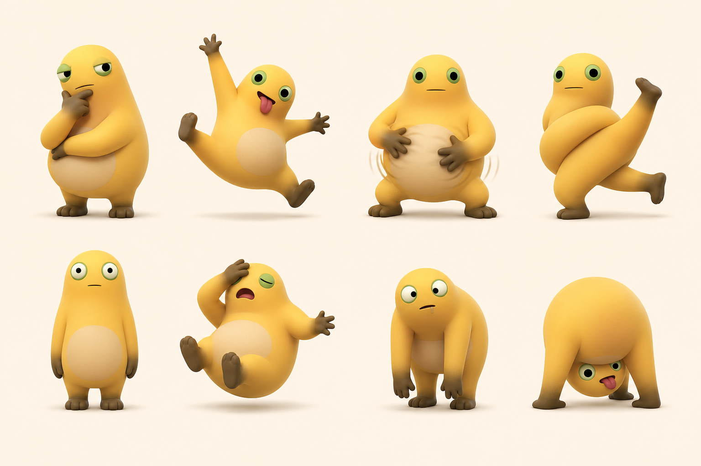
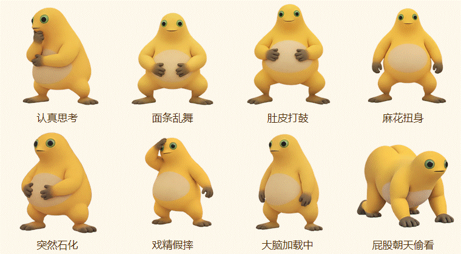
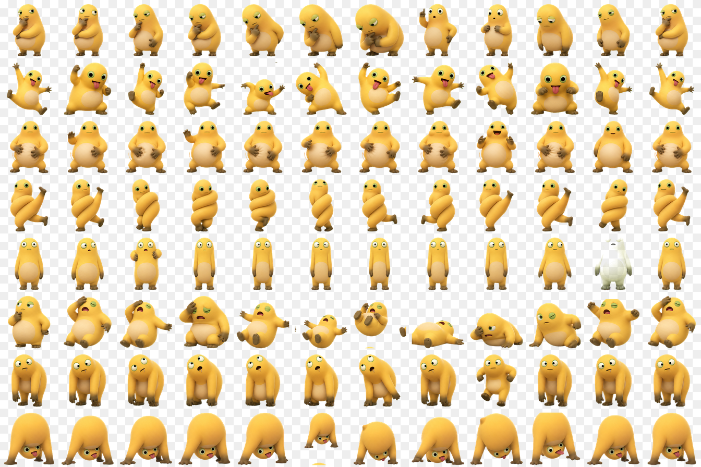

# 奶娃桌面宠物

这是一个无需安装第三方软件的 Windows 桌面宠物。项目现已合并原来的 5 组逐帧动作和 8 组抽象搞怪动作，共 13 个可选动作。

## 运行环境

- Windows 10 或 Windows 11
- 系统自带的 Windows PowerShell 5.1
- 无需安装 Python、Node.js 或第三方运行库

## 启动方法

双击文件夹中的 **启动奶娃桌面宠物.bat**。

如果 Windows 首次运行时弹出安全提示，请确认文件来自你下载的本仓库，再选择继续运行。

## 操作方式

- 左键按住奶娃可以拖动位置。
- 双击奶娃可以手动切换到下一个动作并触发一句对话。
- 右键打开中文菜单，在 **选择动作** 子菜单中可以直接选择 13 个动作，也可以和奶娃说话、暂停或继续走动、退出。
- 按 `Esc` 可以退出。

## 动作设计

1. **抱肚行走**：左右腿交替迈步，身体重心和肚子跟随步态变化。
2. **举手大笑**：抬起双手、比耶、跳起大笑，然后屈膝落地。
3. **坐下啃脚趾**：坐下、弯腰伸手、抬脚，最后抱住脚趾啃。
4. **捧腹大笑**：嘴巴、眼睛、手指、肚皮和弯腰幅度逐帧变化。
5. **趴地摇摆吐舌头**：手肘弯曲、身体前后转移重心，舌头随动作伸缩。
6. **认真思考**：慢慢呼吸、歪头，用怀疑的眼神认真思考。
7. **面条乱舞**：身体腾空，使用不同频率的旋转、弹跳和左右乱甩。
8. **肚皮打鼓**：连续敲击肚皮，碰撞时压扁、随后回弹。
9. **麻花扭身**：身体左右深度扭转，经过中间位置时产生弹性回正。
10. **突然石化**：长时间面无表情地站住，偶尔出现短促抽动。
11. **戏精假摔**：蓄势、腾空、夸张倒下、落地压缩，再慢慢恢复。
12. **大脑加载中**：迟缓摇晃并带有延迟上下浮动，表现完全放空。
13. **屁股朝天偷看**：前后摇摆，低头阶段追加快速抖动和吐舌表情。

当前动画和桌面行走均以原始设计速度的 **0.5 倍速** 播放。

动作不会自动切换，会一直循环当前动作，直到通过右键菜单或双击手动更换。

## 动画预览



## 关键帧动作总览

每组动作使用 12 张独立生成、完整渲染的人物姿态，五组合计 60 张真实帧。人物运动部分以约 8 FPS 连续播放，只在准备、腾空最高点、动作高潮和恢复姿态增加停顿，避免用低帧率强行拉长动作。程序只替换完整帧，不叠加前后姿势，因此不会产生透明残影。


## 抽象搞怪动作设定

新增 8 个动作已重制为每组 12 张独立角色姿势，共 96 张透明逐帧素材。手臂、腿、头部、眼睛、嘴巴、肚皮和身体重心会在帧间真实变化，不再依赖整张图片平移、旋转或缩放。播放时只替换完整帧，不叠加前后画面，因此不会产生残影。



### 新增动作逐帧预览





## 文件说明

- `naiwa-pet.ps1`：桌面宠物主程序。
- `启动奶娃桌面宠物.bat`：Windows 启动文件。
- `assets/animation_detailed/`：60 张无混合、无残影的正式动画帧。
- `assets/funny_detailed/`：8 组、共 96 张透明搞怪动画帧（程序实际使用）。
- `docs/预览/`：动作设定、动态预览和全部关键帧总览。
- `docs/发布到GitHub.md`：创建并推送公共仓库的操作说明。

请保持程序文件和 `assets` 文件夹的相对位置不变。

## 发布到 GitHub

仓库文件已经整理完成，可以直接上传。具体命令见 [docs/发布到GitHub.md](docs/发布到GitHub.md)。GitHub Actions 会在每次推送后自动检查 PowerShell 语法和 156 张动画帧是否齐全。

## 项目结构

```text
奶娃桌面宠物/
├─ assets/
│  ├─ animation_detailed/   # 原有 5 组，共 60 张透明动画帧
│  └─ funny_detailed/       # 新增 8 组，共 96 张透明动画帧
├─ docs/
│  ├─ 预览/                 # GIF、动作设定和关键帧总览
│  └─ 发布到GitHub.md
├─ naiwa-pet.ps1            # 主程序
├─ 启动奶娃桌面宠物.bat       # 双击启动
├─ README.md
└─ .gitignore
```
