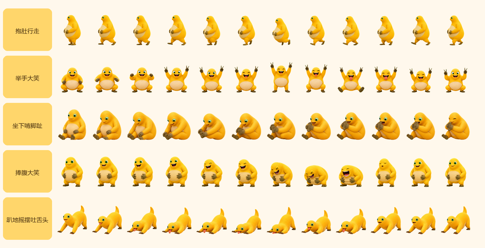

# 奶娃桌面宠物

这是一个无需安装第三方软件的 Windows 桌面宠物。奶娃会在桌面行走，并自动循环播放五组流畅逐帧动作。

## 启动方法

双击文件夹中的 **启动奶娃桌面宠物.bat**。

## 操作方式

- 左键按住奶娃可以拖动位置。
- 双击奶娃可以手动切换到下一个动作并触发一句对话。
- 右键打开中文菜单，在 **选择动作** 子菜单中可以直接选择五个动作，也可以和奶娃说话、暂停或继续走动、退出。
- 按 `Esc` 可以退出。

## 动作设计

1. **抱肚行走**：左右腿交替迈步，身体重心和肚子跟随步态变化。
2. **举手大笑**：抬起双手、比耶、跳起大笑，然后屈膝落地。
3. **坐下啃脚趾**：坐下、弯腰伸手、抬脚，最后抱住脚趾啃。
4. **捧腹大笑**：嘴巴、眼睛、手指、肚皮和弯腰幅度逐帧变化。
5. **趴地摇摆吐舌头**：手肘弯曲、身体前后转移重心，舌头随动作伸缩。

当前动画和桌面行走均以原始设计速度的 **0.5 倍速** 播放。

动作不会自动切换，会一直循环当前动作，直到通过右键菜单或双击手动更换。

## 动画预览


## 关键帧动作总览

每组动作使用 12 张独立生成、完整渲染的人物姿态，五组合计 60 张真实帧。人物运动部分以约 8 FPS 连续播放，只在准备、腾空最高点、动作高潮和恢复姿态增加停顿，避免用低帧率强行拉长动作。程序只替换完整帧，不叠加前后姿势，因此不会产生透明残影。



## 文件说明

- `naiwa-pet.ps1`：桌面宠物主程序。
- `启动奶娃桌面宠物.bat`：Windows 启动文件。
- `assets/animation_detailed/`：60 张无混合、无残影的正式动画帧。
- `逐帧动画预览.gif`：五组动作的动态预览。
- `逐帧动作总览.png`：全部关键帧总览。
- `发布到GitHub.md`：创建并推送公共仓库的操作说明。

请保持程序文件和 `assets` 文件夹的相对位置不变。

## 项目结构

```text
奶娃桌面宠物/
├─ assets/
│  └─ animation_detailed/   # 60 张正式透明动画帧
├─ naiwa-pet.ps1            # 主程序
├─ 启动奶娃桌面宠物.bat       # 双击启动
├─ 逐帧动画预览.gif
├─ 逐帧动作总览.png
├─ README.md
└─ 发布到GitHub.md
```
